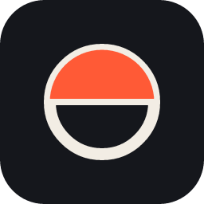

<p align="center">
  
</p>

<h1 align="center">Close Call</h1>

<p align="center">
  Closes or hides the sensitive things you left open before anyone sees your screen.<br>
  Free software that never connects to the internet. In Hungarian: „Bezártam?”
</p>

---

You plug your laptop into the projector to present a group project. Twenty classmates are looking at
your screen. Somewhere behind the slides there is your bank balance, a tab you would really rather
nobody saw, and the invoice you were checking this morning. You remember them the moment the screen
goes up.

Close Call remembers first. When a screen share starts, a projector connects, the lid closes or the
machine has been locked for a while, it closes or hides exactly those items, and leaves your slides
and the meeting app alone.

## Status

**Pre-alpha. There is nothing to download yet.** The macOS version (v0.1) is being built. Windows
follows in v0.2 and Linux in v0.3. [docs/status.md](docs/status.md) says what works today.

## How it works

**Triggers → rules → actions.**

**Triggers.** A screen share or recording starts (best effort, with a confidence level per OS). A
projector or mirrored display connects. The lid closes or the machine goes to sleep. The screen locks,
or you have been away longer than N minutes. You have been idle for N minutes. A sensitive item has
been open longer than N hours. Or you press the panic hotkey (⌃⌥⇧B on macOS, Ctrl+Alt+Shift+B
elsewhere), use the tray menu, or run `closecall panic`. Apps that capture the screen all day to
drive a monitor, such as a DisplayLink dock, and your own desk monitors go on an ignore list, so they
never count as a share or a projector.

**Rules.** Each rule says which triggers arm it, which kinds of things it may touch (browser tabs,
document windows, app windows, processes) and what counts as sensitive: a built-in category
(adult, banking, webmail, medical, password managers, messengers, invoices), a domain, a URL pattern,
a word in the title (accent-insensitive, so `szamla` matches „Számla”), an app, a file path, a
document type, or a private/incognito window. Meeting apps and sites, and the app doing the
capturing, are protected and never touched.

**Actions.** Close, hide, minimize, notify only, or, if you opt in, quit. If an action is not
possible for an item, Close Call only ever falls back to something gentler: close, then hide, then
minimize, then notify.

**Unsaved work is kept by default.** A document with unsaved changes is saved through
its own app and then closed. A document that was never saved goes into `~/Documents/Close Call` where
the app allows it, and is hidden where it does not. If the app cannot tell whether there are unsaved
changes, Close Call assumes there are. It never fills in a Save dialog and never force-quits. Per rule
you can choose to hide instead, leave the document open and notify, or (explicitly) discard.

Closed tabs and documents can be restored for two hours; that list is kept in memory only, and after
those two hours the history forgets which tab or file it was. Every run answers "why was this
closed?" in the Close Call window, and a dry run shows what would happen without touching anything.

The design in more detail: [docs/architecture.md](docs/architecture.md).

## Privacy

Close Call never opens a network connection. No telemetry, no accounts, no crash reporter, no update
checks. The site lists ship with the app and change only with a release. Window
titles, URLs and file paths are never written to logs or shown in notifications. Details:
[PRIVACY.md](PRIVACY.md).

### Check the privacy promise

The rule is enforced in layers, so you do not have to take our word for it.

| Layer | What to look at |
|---|---|
| Dependencies | `deny.toml` bans HTTP, TLS and WebSocket crates (`reqwest`, `hyper`, `ureq`, `rustls`, `tungstenite` and more). Run `cargo deny check bans`. |
| Rust code | Clippy's `disallowed-types` forbids `std::net` and `tokio::net` sockets. |
| UI code | Biome forbids `fetch`, `XMLHttpRequest`, `WebSocket` and `EventSource`. |
| Webview | The CSP in [app/src-tauri/tauri.conf.json](app/src-tauri/tauri.conf.json) allows connections only to Tauri's IPC: `connect-src ipc: http://ipc.localhost`. |
| Tauri plugins | No updater, HTTP, WebSocket or upload plugin. |
| Runtime | [CI](.github/workflows/ci.yml) runs scripted scenarios under `strace` and fails on any `AF_INET` or `AF_INET6` socket, then runs them again with no network at all (`unshare -rn`). |
| Your machine | LuLu or Little Snitch shows no connection attempts. `lsof -nP -i -a -p <pid>` prints nothing. |

These checks are being set up during v0.1; [docs/status.md](docs/status.md) tracks which are live.
The OS webview runtime and Gatekeeper are parts of your OS that can use the network on their own;
[docs/threat-model.md](docs/threat-model.md) covers that and what Close Call cannot protect against.

## How it compares

Other tools cover one part of the problem. As of November 2026 (details and sources in
[docs/research/competitive-analysis.md](docs/research/competitive-analysis.md)):

| Approach | Examples | Better than Close Call at | Where it stops |
|---|---|---|---|
| Hide everything when sharing starts | Stealthly (macOS) | Polished; also hides desktop icons and the Dock | Hides every window regardless of content, macOS only, closed source |
| Presentation and boss-key modes | PliimPRO, Boss Key | One click, restores the previous state | Manual and all-or-nothing |
| Hide windows from capture | Invisiwind, HideMyWindows (Windows), Unshown (macOS) | The window stays visible to you and invisible to the audience | Windows tools inject DLLs; macOS ones need you to share their proxy window; the content stays open |
| Browser panic buttons and tab managers | Panic Button extensions, Tab Wrangler, LeechBlock NG | No extra app; mature rule editors | One browser, no share, lid or lock triggers |
| Idle quitters | AutoQuit, Raycast | Per-app timers | Whole apps only, built for focus rather than privacy |
| Built-in OS and meeting-app features | Sharing a single window in Zoom, Teams, Meet or the macOS picker | The cheapest real protection; use it | Does not help when you share the whole screen or plug into a projector |

What Close Call adds: it chooses by content (domain, file, app, title) across tabs, documents and
apps with one rule set; it acts before exposure (lock, sleep, lid, a call about to start) as well as
when a share starts; it has an explicit policy for unsaved work; and the no-network claim is
checkable. It does not hide windows from a capture while keeping them on your screen, and detection
of a share is reactive, so the first fraction of a second can still go out.

## Build from source

You need Rust (through rustup; the version is pinned in `rust-toolchain.toml`), [bun](https://bun.sh)
1.3 or newer, and for the app macOS 14+ with the Xcode Command Line Tools.

```sh
git clone https://github.com/futozs/closecall
cd closecall
bun install
bun run dev
```

`cargo test` runs the core, list and engine tests on any OS. Testing macOS permissions needs a
signed app bundle; see [docs/platforms/macos.md](docs/platforms/macos.md#development).

## Configuration

Rules live in a TOML file that the settings window also edits. A setup close to the recommended preset:

```toml
version = 1
language = "system"
panic_hotkey = "Ctrl+Alt+Shift+B"

[[rule]]
id = "share-close-sensitive-tabs"
when = ["panic", "screen_share", "display_mirrored"]
targets = ["tab"]
match = { any = [{ category = "adult" }, { category = "banking" }, { category = "webmail" }, { category = "medical" }, "private"] }
action = "close"

[[rule]]
id = "share-hide-private-apps"
when = ["panic", "screen_share", "display_mirrored"]
targets = ["app_window", "process"]
match = { any = [{ category = "password_managers" }, { category = "messengers" }] }
action = "hide"

[[rule]]
id = "share-close-invoices"
when = ["panic", "screen_share", "display_mirrored", "lid_closed"]
targets = ["document"]
match = { category = "invoices" }
action = "close"

[[rule]]
id = "away-close-banking"
when = [{ away_longer_than = "15m" }]
targets = ["tab"]
match = { category = "banking" }
action = "close"
```

Every key, trigger, matcher and policy is described in [docs/config.md](docs/config.md). The JSON
Schema is [schema/config.schema.json](schema/config.schema.json).

## Roadmap

| Version | Scope |
|---|---|
| v0.1 | macOS 14+: tabs in Chromium browsers, Arc and Safari, documents, apps; all triggers; unsaved-work policies; restore |
| v0.2 | Windows 10 and 11 |
| v0.3 | Linux on X11, with share detection on Wayland |
| v0.4 | Companion browser extension: exact URLs and per-tab close everywhere, including Firefox |
| v0.5 | Window control on Wayland (KDE, wlroots, COSMIC, GNOME) |
| v0.6 | Optional on-device image classification, off by default |

More in [docs/roadmap.md](docs/roadmap.md).

## Contributing

Bug reports, device test results and translations help the most. Start with
[CONTRIBUTING.md](CONTRIBUTING.md). Coding agents read [AGENTS.md](AGENTS.md); the reasons behind the
big decisions are in [docs/decisions/](docs/decisions/README.md). Security problems go through
[SECURITY.md](SECURITY.md), not public issues. Everyone is expected to follow the
[code of conduct](CODE_OF_CONDUCT.md).

## Licence

Close Call is free software under the [GNU General Public License v3.0 or later](LICENSE). The
bundled domain lists keep their upstream licences; each source, licence and snapshot date is recorded
in [lists/manifest.toml](lists/manifest.toml) and shown in the app under About.

## „Bezártam?”

Ismerős a helyzet: kivetíted a prezentációt az órán, és mögötte ott a netbank, egy lap, amit inkább
senki ne lásson, meg a villanyszámla PDF-je. A Close Call ezeket zárja be vagy rejti el, amikor
elindul a képernyőmegosztás, rácsatlakozol a projektorra, lecsukod a laptopot, vagy a gép sokáig le
volt zárva. A prezentációhoz és a Zoomhoz nem nyúl.

Nem csatlakozik az internethez, és a mentetlen munkádat sem dobja el: a dokumentumot előbb elmenti,
és csak utána zárja be, ha pedig ez nem megy, elrejti. A felület angolul és magyarul is elérhető. Az
első kiadás macOS-re készül, utána jön a Windows és a Linux.
